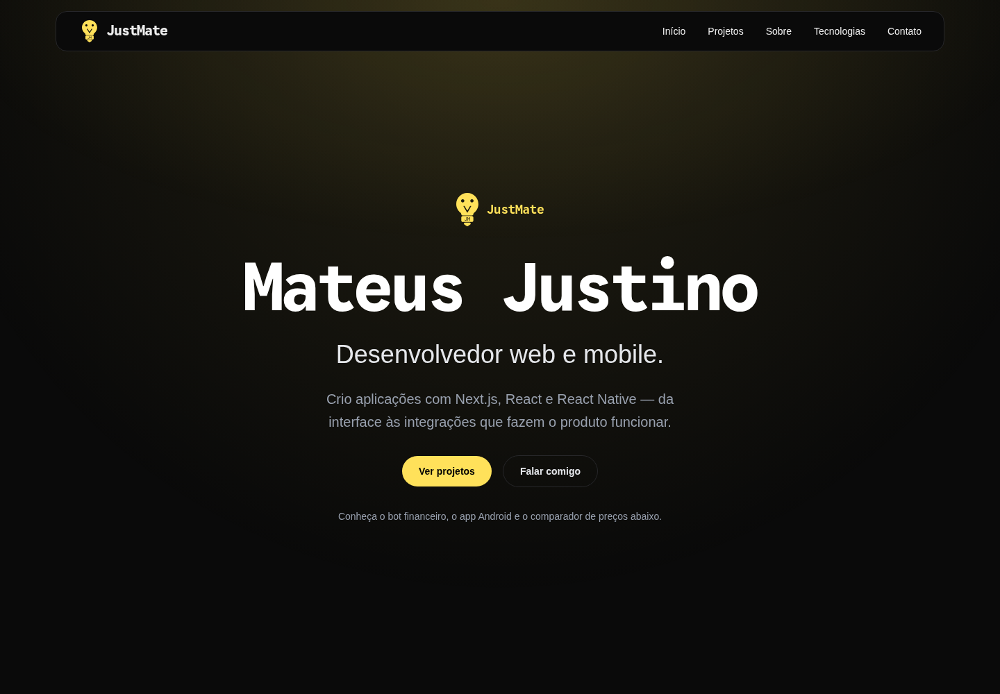

# JustMate — Portfólio

Sou Mateus Justino, desenvolvedor web e mobile. Este portfólio reúne três produtos que desenvolvi individualmente, da interface às integrações, com os problemas que resolvem, decisões técnicas e limites de cada solução.

**[Ver portfólio →](https://justmate.vercel.app)**



## Projetos em destaque

| Projeto | O que faz | Tecnologias principais |
| --- | --- | --- |
| [Zelumi](https://justmate.vercel.app/projetos/zelumi) | Registro de receitas e despesas pelo Telegram, com painel web para acompanhar lançamentos, parcelas e categorias. | Next.js, TypeScript, Cloudflare Workers e D1 |
| [Thinkdo](https://justmate.vercel.app/projetos/thinkdo) | Aplicativo Android de notas e tarefas com sincronização na nuvem, lembretes e widgets na tela inicial. | React Native, Expo, TypeScript e Firebase |
| [Sinalverde](https://justmate.vercel.app/projetos/sinalverde) | Comparação de preços de jogos na Steam e na Nuuvem, com histórico, wishlist e alertas por e-mail. | Next.js, TypeScript, PostgreSQL e Prisma |

Cada página apresenta o contexto do produto, minha contribuição, capturas da interface e decisões de implementação, além dos links para o código e para acessar o produto.

## Sobre este repositório

Este repositório contém o site do portfólio. O código dos produtos apresentados está em seus respectivos repositórios: [Zelumi](https://github.com/justmatedev/zelumi), [Thinkdo](https://github.com/justmatedev/thinkdo) e [Sinalverde](https://github.com/justmatedev/sinalverde).

O site foi construído com **Next.js 16, React 19, TypeScript e Tailwind CSS 4**. Os ícones usam React Icons / Simple Icons, e a fonte Google Sans Code é hospedada localmente.

- **Conteúdo centralizado:** textos, links e imagens dos projetos são definidos em um arquivo JSON, compartilhado entre a página inicial e as páginas individuais.
- **Páginas geradas no build:** cada projeto tem uma rota própria em `/projetos/[slug]`, gerada com `generateStaticParams`.
- **Metadados por projeto:** título, descrição, URL canônica e imagens de compartilhamento, além de sitemap com as páginas dos projetos e configuração de robots.
- **Interface responsiva:** navegação mobile, indicadores de foco e tratamento de movimento reduzido nas animações principais.
- **Recursos locais:** capturas dos projetos e fonte servidas pela própria aplicação.

## Executar localmente

Use uma versão LTS do Node.js compatível com o projeto (mínimo 20.9) e npm.

```bash
npm ci
npm run dev
```

Abra [localhost:3000](http://localhost:3000). O portfólio não exige variáveis de ambiente nem credenciais para rodar.

### Validação e produção

```bash
npm run lint
npm run build
npm start
```

O comando `start` serve o build de produção e deve ser executado após `build`.

## Estrutura e conteúdo

```text
docs/images/                # Captura do portfólio usada neste README
src/
├── app/                    # Página inicial, metadados, sitemap e robots
│   └── projetos/[slug]/     # Páginas individuais dos projetos
├── components/             # Seções da página e componentes compartilhados
├── data/projects.json      # Textos, links e imagens dos projetos
└── fonts/                  # Fonte local e licença OFL
public/
└── projects/               # Capturas e símbolos dos projetos
```

Para atualizar os projetos, edite `src/data/projects.json` e adicione as imagens em `public/projects/`. Os slugs geram as páginas individuais e as entradas do sitemap durante o build.

A apresentação e os contatos ficam em `src/components/`. Ao mudar o domínio, atualize as URLs em `src/app/layout.tsx`, `src/app/robots.ts` e `src/app/sitemap.ts`.

## Contato

Busco oportunidades em desenvolvimento web e mobile.

- [E-mail](mailto:justmatedev@gmail.com)
- [GitHub](https://github.com/justmatedev)

## Licença

Este projeto é de código aberto e está disponível sob a [licença MIT](LICENSE).

Fontes, ícones e dependências de terceiros mantêm suas respectivas licenças. A licença da fonte Google Sans Code está em [src/fonts/OFL.txt](src/fonts/OFL.txt).
